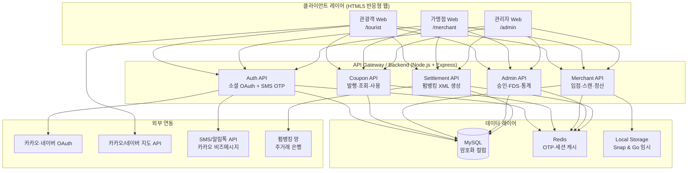

# 옹진관광 쿠폰 통합 플랫폼 — 기획 분석 & 구현 로드맵

> **작성일**: 2026-04-22 | **스택**: Node.js(Express) + MySQL + HTML5 반응형 모바일 웹

---

## 1. 시스템 전체 아키텍처



---

## 2. 사용자 포털 (관광객 /tourist)

### 2-1. 인증

| 방식             | 구현 포인트                                                             |
| ---------------- | ----------------------------------------------------------------------- |
| 카카오 OAuth 2.0 | `GET /auth/kakao` → 콜백 → JWT 발급                                     |
| 네이버 OAuth 2.0 | `GET /auth/naver` → 콜백 → JWT 발급                                     |
| 구글 OAuth 2.0   | `GET /auth/google` → 콜백 → JWT 발급                                    |
| 공통             | 최초 로그인 시 휴대폰 번호 수집 → **SHA-256 + Salt** 단방향 암호화 저장 |

### 2-2. 마이페이지 (디지털 지갑)

- **쿠폰 목록**: 알림톡 발송 후 DB 연동 → 상태별(사용가능/사용완료/만료) 탭 분류
- **종이쿠폰 디지털화**
  - 텍스트 입력: 난수 번호 직접 입력
  - 카메라 스캔: `<input type="file" capture="camera">` → 바코드 디코딩 (`ZXing.js`)
  - 검증 후 마이페이지 잔액 합산

### 2-3. 지도 기능

- 카카오/네이버 지도 API 중 선택 1종 채택 (카카오 권장 — 한국 커버리지 우세)
- 현재 위치 기반 가맹점 마커, 관광지 레이어 토글

### 2-4. 가맹점 입점 신청 (사용자 메뉴 내 포함)

- 신청 폼 → 관리자 승인 대기 상태 → 승인 시 SMS 알림

---

## 3. 가맹점 포털 (/merchant)

### 3-1. Zero-Password 로그인

```
상점명 입력 → 대표자 휴대폰 번호 입력 → SMS OTP(6자리, TTL 3분) 발송
→ OTP 검증 → JWT(가맹점 롤) 발급
```

- OTP는 Redis에 `merchant:otp:{phone_hash}` 키로 TTL 180초 저장
- 전화번호는 SHA-256 + 앱 salt 로 저장 (원문 보관 금지)

### 3-2. QR 스캔 결제 (Snap & Go)

```mermaid
sequenceDiagram
    가맹점 직원->>카메라: <input capture="camera"> 촬영
    카메라-->>브라우저: 이미지 반환
    브라우저->>JS: QR 디코딩 (jsQR)
    alt 온라인 정상
        JS->>API: POST /merchant/scan {couponCode}
        API-->>JS: 정산 결과
    else 오프라인 / 통신 장애
        JS->>LocalStorage: 스캔 데이터 큐 저장
        note over JS: 연결 복구 감지 (navigator.onLine)
        JS->>API: 큐 일괄 전송 (비동기)
        API-->>JS: 사후 정산 완료
    end
```



> **⚠️ 보안**: LocalStorage 저장 데이터는 **AES-GCM(WebCrypto API)** 로 암호화, 재전송 시 서버에서 재검증

---

## 4. 관리자 포털 (/admin)

### 4-1. 통합 대시보드

| 위젯                 | 데이터 소스                |
| -------------------- | -------------------------- |
| 쿠폰 발행액 / 회수율 | `coupon_transactions` 집계 |
| 가맹점 가입률        | `merchants` 상태별 COUNT   |
| 일별 사용 추이       | Chart.js 라인 차트         |
| FDS 이상 탐지 알림   | 단시간 다중 스캔 룰 기반   |

### 4-2. 가맹점 관리

- 입점 신청 목록 → 승인 / 반려 액션 → SMS 자동 발송
- 가맹점별 거래 내역 드릴다운

### 4-3. FDS (이상거래 탐지)

- 룰 기반 1차: 동일 쿠폰 5분 내 2회 이상 사용 시 자동 차단 + 관리자 알림
- 로그 테이블 별도 분리: `fds_alerts`

### 4-4. 펌뱅킹 자동 정산 모듈

```
스케줄러 (매월 1일 00:00, node-cron)
  → 전월 정산 대상 가맹점 쿼리
  → 은행 표준 XML / 텍스트 이체 파일 자동 생성
  → 파일 S3 또는 FTP 업로드 + 관리자 이메일 통보
  → settlement_logs 기록
```

---

## 5. DB 스키마 개요

```sql
-- 핵심 테이블 목록 (상세 ERD는 별도 작성)
users             -- 관광객 (social_provider, phone_hash, created_at)
merchants         -- 가맹점 (name, phone_hash, status, approved_at)
coupons           -- 쿠폰 원장 (code_hash, face_value, status, issued_to)
coupon_transactions -- 사용 이력 (coupon_id, merchant_id, used_at, amount)
paper_coupons     -- 종이쿠폰 원장 (random_code_hash, face_value, converted)
settlements       -- 정산 원장 (merchant_id, period, amount, status)
fds_alerts        -- FDS 알림 (rule_id, coupon_id, detected_at, resolved)
otp_sessions      -- (Redis 대체 불가 시 임시 테이블, TTL 컬럼 필요)
```

> **개인정보 암호화 원칙**: 전화번호(`phone_hash`) → `SHA-256(phone + APP_SALT)`, 쿠폰 코드(`code_hash`) 동일 방식

---

## 6. 보안 체크리스트 (OWASP Top 10 대응)

| OWASP 항목                    | 대응 방안                                            |
| ----------------------------- | ---------------------------------------------------- |
| A01 Broken Access Control     | JWT + Role 미들웨어 (tourist/merchant/admin)         |
| A02 Cryptographic Failures    | bcrypt(비밀번호), SHA-256+salt(전화번호), HTTPS 강제 |
| A03 Injection                 | Prepared Statement (mysql2), 파라미터 바인딩         |
| A05 Security Misconfiguration | helmet.js, CORS 화이트리스트, rate-limit             |
| A07 Auth Failures             | OTP TTL 3분, JWT 만료 1시간, Refresh Token Rotation  |
| A09 Logging                   | morgan + winston, FDS 이벤트 별도 로그               |

---

## 7. 개발 단계 로드맵

```
Phase 1 — 기반 (2일)
  ✅ DB 스키마 확정 & 마이그레이션 스크립트
  ✅ Express 프로젝트 구조 세팅 (라우터/미들웨어/env)
  ✅ 소셜 OAuth 연동 (카카오 → 네이버 → 구글 순)
  ✅ JWT 인증 미들웨어

Phase 2 — 핵심 기능 (3일)
  ✅ 쿠폰 발행 / 조회 / 사용 API
  ✅ 종이쿠폰 디지털화 (ZXing.js 바코드 스캔)
  ✅ 가맹점 Zero-Password 로그인 + OTP (Redis)
  ✅ QR 스캔 결제 + Snap & Go (LocalStorage 큐)

Phase 3 — 관리자 & 고도화 (1주)
  ✅ 관리자 대시보드 + Chart.js
  ✅ FDS 룰 엔진
  ✅ 펌뱅킹 정산 XML 생성 모듈

Phase 4 — 보안 & 배포 (1주)
  ✅ OWASP 점검, Helmet/Rate-limit
  ✅ HTTPS + Nginx 리버스 프록시
  ✅ PM2 클러스터 모드, 모니터링
```

---

## 8. 기술 스택 확정

| 영역           | 선택                                                        |
| -------------- | ----------------------------------------------------------- |
| Frontend       | Vanilla HTML5 + CSS3 + Vanilla JS (모바일 웹)               |
| Backend        | Node.js 20 + Express 5                                      |
| DB             | MySQL 8.0                                                   |
| Cache/OTP      | Redis 7                                                     |
| 인증           | Passport.js (OAuth) + jose (JWT)                            |
| 바코드/QR      | ZXing.js (바코드), jsQR (QR)                                |
| 지도           | 카카오맵 JS SDK                                             |
| SMS (OTP·알림) | **NHN Cloud SMS API** (카카오 비즈메시지 채널 개설 전 대체) |
| 알림톡         | 카카오 비즈메시지 (채널 개설 후 전환 예정)                  |
| 스케줄러       | node-cron                                                   |
| 보안           | helmet, express-rate-limit, cors                            |
| 배포           | Nginx + PM2 + Let's Encrypt (121.125.61.114)                |

---

## 9. 서버 배포 환경 (121.125.61.114 — 확정)

> 기존 KI 기준 `210.114.17.180`은 별개 서버. `121.125.61.114`는 멀티테넌트 신규 격리 서버.

### 포트 배정 계획

| Port                | 서비스                      | 비고          |
| ------------------- | --------------------------- | ------------- |
| 80 / 443            | Nginx (HTTPS 리버스 프록시) | Let's Encrypt |
| **3010**            | 옹진관광 Backend (PM2)      | 신규 배정     |
| 기존 3001·3002·3004 | 타 서비스                   | 충돌 회피     |

### 디렉토리 구조

```
/var/www/ongjin-coupon/      ← Nginx 정적 파일 서빙
/root/ongjin-coupon/         ← Node.js 백엔드 소스 + PM2 실행
```

### PM2 프로세스명

- `ongjin-backend` (포트 3010)

---

## 10. 결정된 사항 & 잔여 확인 필요 사항

### ✅ 확정

| 항목        | 결정 내용                                                                      |
| ----------- | ------------------------------------------------------------------------------ |
| 호스팅 서버 | `121.125.61.114` (Cafe24 격리 서버)                                            |
| 펌뱅킹      | **1단계**: 정산 파일(XML/Text) 자동 생성 모듈만 구현, 실제 전송은 은행 계약 후 |
| SMS/OTP     | **NHN Cloud SMS** 로 우선 구현, 카카오 비즈메시지 채널 개설 후 알림톡 전환     |

### ❓ 아직 미확인

2. **카카오맵 API Key**: 앱 등록 및 키 발급 여부
3. **소셜 OAuth App 등록**: 카카오·네이버·구글 개발자 콘솔 앱 생성 여부
4. **NHN Cloud 계정**: SMS API 발신번호 등록 여부

